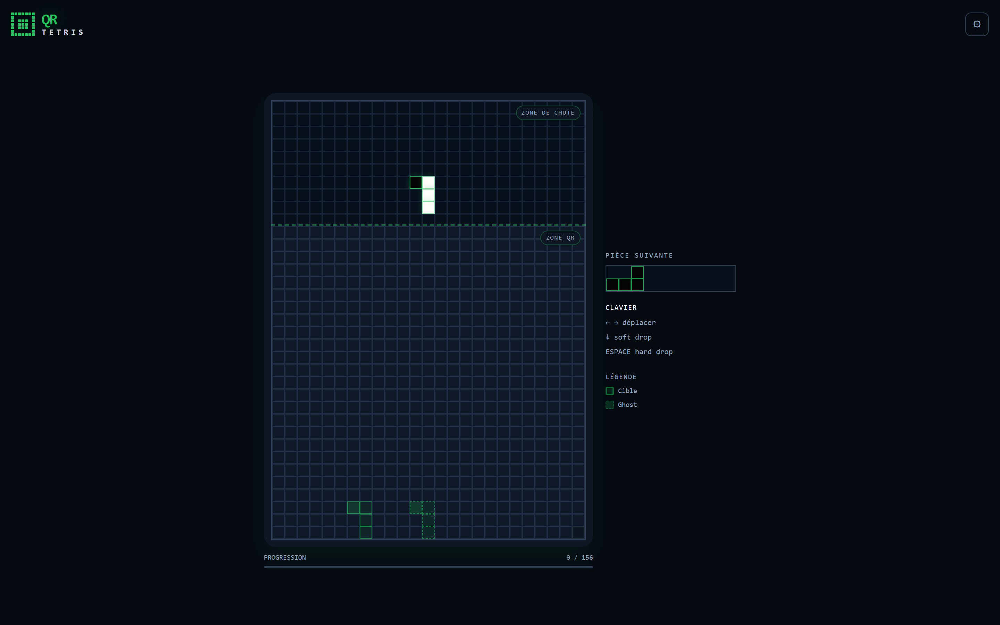

# QR Tetris

Générer un QR code, c'était bien trop facile. **QR Tetris** est un générateur de QR code… jouable : le QR code de votre URL (ou de n'importe quel texte) est découpé en tétrominos qui tombent un à un, et c'est à vous de les placer, façon Tetris. Chaque pièce doit atterrir exactement à sa place — une erreur et la partie est perdue. À la fin, la grille reconstituée est un vrai QR code, scannable directement sur le plateau.

**➡️ Jouer maintenant : [qr-tetris.douay.me](https://qr-tetris.douay.me/)**



## Comment ça marche

Le cœur du projet est un solveur de pavage (`components/qr-tetris/logic.ts`) qui transforme un QR code en une partie de Tetris gagnable :

1. **Génération du QR** — Le texte saisi est encodé en QR code (niveau de correction M) via la bibliothèque [`qrcode`](https://www.npmjs.com/package/qrcode), ce qui donne une matrice carrée de modules noirs/blancs.

2. **Pavage en tétrominos** — La grille entière (moins une unique cellule « ancre » pré-posée dans le coin inférieur droit, pour que le nombre de cellules restantes soit divisible par 4) doit être recouverte par des tétrominos : les 7 pièces classiques du Tetris, dans toutes leurs rotations. C'est un problème de couverture exacte, résolu par **backtracking**.

3. **Découpage en régions macro** — Plutôt que d'attaquer toute la grille d'un coup (explosion combinatoire), la grille est découpée en régions de blocs 4×4 (regroupés en régions 1×1, 1×2 ou 2×1 blocs, tirées aléatoirement), résolues indépendamment du bas vers le haut. Si une région multi-blocs résiste, elle est re-découpée en blocs individuels. Les régions du dernier rang/colonne absorbent la bordure de la grille pour éviter un monopole de pièces « I ».

4. **Heuristique MRV et cache de dead-ends** — À chaque étape, le solveur traite la rangée non couverte la plus basse et y choisit la cellule qui a le **moins d'options de placement** (heuristique *Minimum Remaining Values*), ce qui détecte les impasses au plus tôt. Les états déjà identifiés comme sans issue sont mémorisés dans un **cache de dead-ends** pour ne jamais les ré-explorer. Un léger biais favorise les orientations de pièces encore peu utilisées, pour varier les formes.

5. **Jouabilité garantie** — Un pavage valide ne suffit pas : chaque pièce doit aussi être *jouable*. Le solveur vérifie par un parcours en largeur (BFS) qu'il existe une colonne d'apparition depuis laquelle la pièce peut réellement descendre jusqu'à sa position cible avec les seuls déplacements du Tetris (gauche, droite, descente), et qu'elle s'y verrouille naturellement. C'est pourquoi les pièces sont ordonnées de bas en haut.

6. **Garde-fous** — Le solveur est borné en temps (3 s) et en nombre d'étapes (120 000) par tentative ; jusqu'à 8 tentatives sont lancées et une solution est tirée au hasard parmi celles qui aboutissent, pour que chaque partie soit différente.

## Stack technique

- [Next.js 16](https://nextjs.org/) (App Router) + [React 19](https://react.dev/)
- [TypeScript](https://www.typescriptlang.org/) (mode strict)
- [Tailwind CSS 4](https://tailwindcss.com/)
- [qrcode](https://www.npmjs.com/package/qrcode) pour l'encodage QR
- [Vitest](https://vitest.dev/) pour les tests unitaires

## Installation

```bash
git clone https://github.com/Goose254/qr-tetris.git
cd qr-tetris
npm install
```

### Développement

```bash
npm run dev
```

Puis ouvrez [http://localhost:3000](http://localhost:3000).

### Build de production

```bash
npm run build
npm start
```

### Tests et lint

```bash
npm test
npm run lint
```

## Licence

Distribué sous licence [MIT](LICENSE). © 2026 Vincent Douay.
